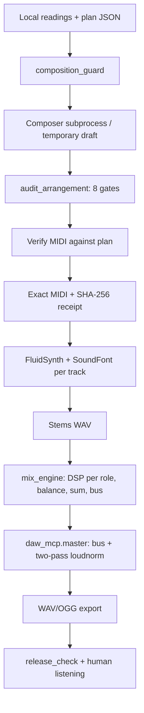

# Current architecture

The repository contains two components that use files as their interface:
audited MIDI composition and offline audio processing. There is no real-time
server. `daw_mcp.py` exposes functions through FastMCP/stdio without changing
the original Python functions.

## Modules and responsibilities

| Module | Inputs → outputs / responsibility |
| --- | --- |
| `hermesmusic.py` | SongSpec or events → MIDI; vocabulary for notes, scales, chords, patterns, and absolute→delta timing. `render_song` audits before publishing; `render_performance` reconstructs supported performance fields, without promising lossless MIDI preservation. |
| `audit_arrangement.py` | MIDI → report on structure, dynamics, register, space, overlap, patterns, density, and fills. `ArrangementError`/exit 1 block a defective arrangement. |
| `composition_guard.py` | Readings + plan + composer command → MIDI and certificate only after gates and comparison against the plan. `--verify` reruns the audit and checks hashes. |
| `example_dense_arrangement.py` | Corrected original reference: 120 bars, written note by note. Its musical decisions are preserved. |
| `genre_engine.py` | Metadata and seed → harmonic plan or piano guide. Does not implement 100 complete genres. |
| `mix_engine.py` | WAVs named by role → 44100 Hz stereo. Per-role HPF/EQ/compression, linear stereo balance, levels, floating-point summing, and master bus. Two explicit profiles. |
| `daw_mcp.py` | Ten Python tools registered by `build_server`. Rendering, measurement, processing, mixing, mastering, comparison, verification. |
| `audio_utils.py` | Audio and destination validation, writes via temporary-file replacement, binary/SoundFont discovery, subprocesses with timeout and error handling, FFmpeg measurement. |
| `check_install.py` | Dependency and resource checks, without an external music project. |

## Preserved invariants

MIDI events are built in absolute ticks, sorted, and converted to delta times.
Never hide negative deltas. `validate_midi` is complementary: it does not replace
the arrangement gates. The composition guard uses temporary files and links that prevent overwrites to
publish MIDI/certificates. The certificate binds the MIDI, saved plan, readings,
and three engine/auditor/guard files; it is not a signature and does not cover all software
or dependencies. It does not yet bind the bytes of the executed composer.

The auditor is preserved. Guard changes cover local paths, package imports,
and actionable messages. The monolithic composition engine was not refactored.

Audio is loaded as `float32`, mono/stereo, with no empty frames, NaN/inf, or total
silence. Mixing converts mono to stereo and resamples; default duration matches
the longest stem. Unknown roles abort. Complete files are
loaded into RAM: cost is roughly proportional to samples × channels × stems.

Floating-point summing can exceed 0 dBFS internally without quantization; this does not
by itself imply clipping in a PCM file. Trim precedes the sample limiter,
and the written file is measured. Mastering uses FFmpeg for actual LUFS/TP;
lossy output is measured again. Do not confuse a sample limiter with a
true peak guarantee.

## Interface boundaries

MCP does not expose composition or require a receipt when rendering: the agent must follow
PROTOCOL.md and verify it first. The renderer separates one named track per channel;
it does not reconstruct programs/controllers distributed across tracks. Track names
cannot become arbitrary paths. Tools operate with the
host process's permissions; they are not a sandbox.

Receipts include absolute paths and are sensitive to reading/code changes;
the packaged sample is audited and recertified locally by
rerunning the example. The OGG is linked by hashes in its sample notes,
but the MIDI guard does not certify audio.

Tests: the 33 composition regressions and 100 catalog subtests are retained,
with reproducible fixtures. New tests process real synthetic WAVs,
execute DSP, and call the ten tools through an MCP stdio client.
CI installs binaries and a SoundFont; it requires neither physical audio hardware nor a GPU.
