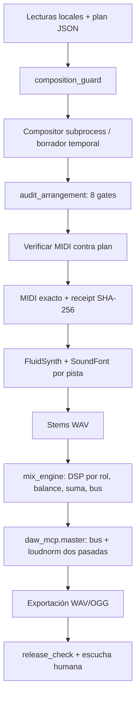

# Arquitectura vigente

El repositorio contiene dos componentes que comparten archivos como interfaz:
composición MIDI auditada y procesamiento offline de audio. No hay servidor de
audio en tiempo real. `daw_mcp.py` expone funciones por FastMCP/stdio sin cambiar
las funciones Python originales.

## Módulos y responsabilidad

| Módulo | Entradas → salidas / propiedad |
| --- | --- |
| `hermesmusic.py` | SongSpec o eventos → MIDI; vocabulario de notas, escalas, acordes, patrones y timing absoluto→delta. `render_song` audita antes de publicar; `render_performance` es reconstrucción de material ajeno. |
| `audit_arrangement.py` | MIDI → informe de estructura, dinámica, registro, espacio, solapamiento, patrones, densidad y fills. `ArrangementError`/exit 1 bloquean un arreglo defectuoso. |
| `composition_guard.py` | Lecturas + plan + comando de compositor → MIDI y certificado solo tras gates y comparación con el plan. `--verify` repite auditoría y comprueba hashes. |
| `example_dense_arrangement.py` | Referencia original corregida: 120 compases, autoría nota a nota. Se preservan sus decisiones musicales. |
| `genre_engine.py` | Metadatos y semilla → plan armónico, o guía de piano. No implementa 100 géneros completos. |
| `mix_engine.py` | WAVs por nombre de rol → estéreo 44100 Hz. HPF/EQ/compresión por rol, balance lineal, niveles, suma float y bus master. Dos perfiles explícitos. |
| `daw_mcp.py` | Diez herramientas Python registradas por `build_server`. Render, medición, procesado, mezcla, master, comparación, verificación. |
| `audio_utils.py` | Validación de audio y destino, escritura por reemplazo temporal, discovery de binarios/SoundFont, subprocess con timeout y errores, medición FFmpeg. |
| `check_install.py` | Comprobaciones de dependencias y recursos, sin proyecto musical externo. |

## Invariantes conservadas

Eventos MIDI se construyen en ticks absolutos, se ordenan y se convierten a delta.
Nunca ocultar deltas negativos. `validate_midi` es complementario: no reemplaza
los gates. El guard usa archivos temporales y enlaces sin sobrescritura para
publicar MIDI/certificado. El certificado vincula MIDI, plan guardado, lecturas
y tres archivos de motor/auditor/guard; no es una firma ni cubre todo el software
o las dependencias. No vincula todavía los bytes del compositor ejecutado.

Se preserva el auditor. Los cambios al guard son rutas locales, imports de paquete
y mensajes accionables. No se refactorizó el motor de composición monolítico.

Audio se carga como `float32`, mono/estéreo, sin frames vacíos, NaN/inf ni silencio
total. La mezcla convierte mono a estéreo y remuestrea; duración por defecto es
la del stem más largo. Roles desconocidos abortan. Los archivos completos se
cargan en RAM: coste aproximadamente proporcional a muestras × canales × stems.

La suma float puede superar 0 dBFS internamente sin cuantización; eso no equivale
por sí solo a clipping de un archivo PCM. Hay trim antes del limitador de muestras
y se mide el archivo escrito. El master usa FFmpeg para LUFS/TP reales; la
salida con pérdida se mide de nuevo. No confundir limitador de muestras con una
garantía de true peak.

## Límites de frontera

El MCP no expone composición ni exige recibo al renderizar: el agente debe seguir
PROTOCOL.md y verificarlo primero. El renderer separa una pista nominal por canal;
no reconstruye programas/controladores repartidos entre pistas. Nombres de pista
no pueden convertirse en rutas arbitrarias. Las herramientas trabajan con los
permisos del proceso anfitrión; no son un sandbox.

Los recibos incluyen rutas absolutas y son sensibles a cambios de lectura/código;
la muestra empaquetada se audita de nuevo y se vuelve a certificar localmente
reproduciendo el ejemplo. El OGG está enlazado por hashes en sus notas de muestra,
pero el guard MIDI no certifica el audio.

Pruebas: se mantienen las 33 regresiones de composición y 100 subtests de catálogo,
con fixtures reproducibles. Las nuevas pruebas procesan WAVs sintéticos reales,
ejecutan el DSP y llaman a las diez herramientas mediante cliente MCP stdio.
CI instala binarios y SoundFont; no necesita audio físico ni GPU.
